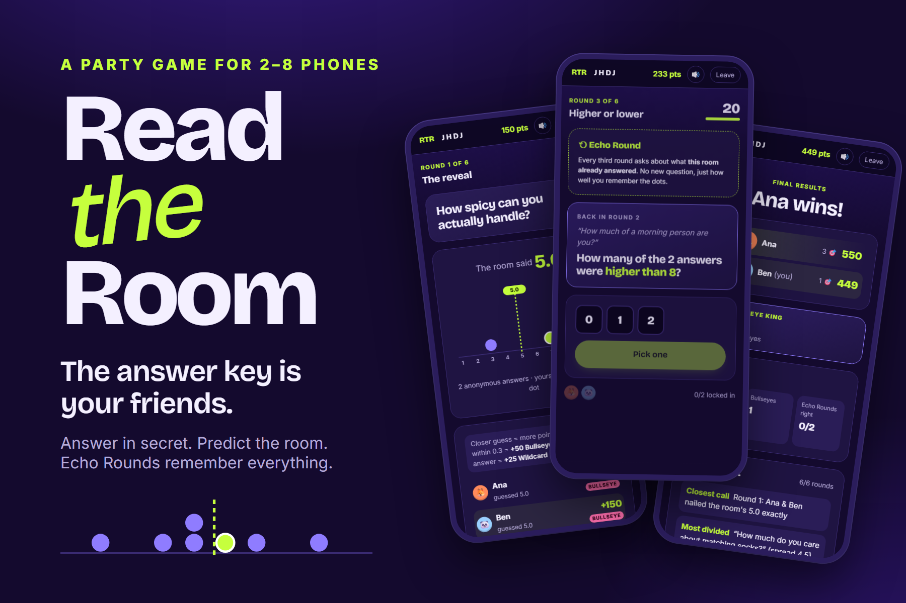
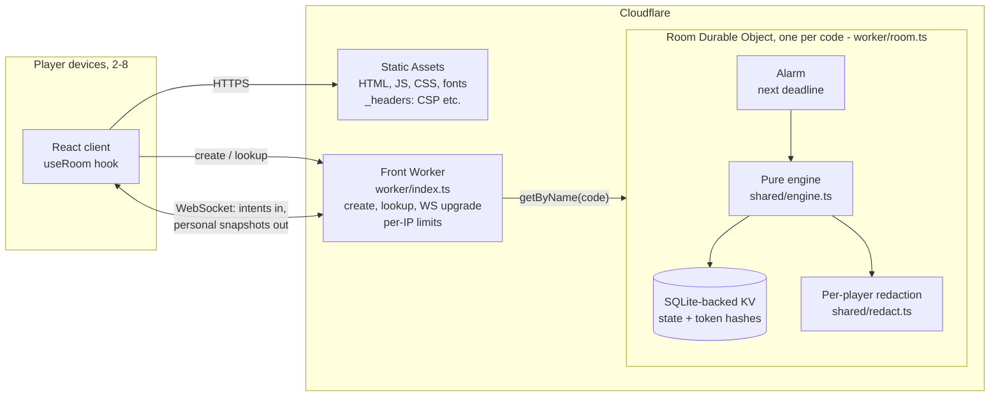
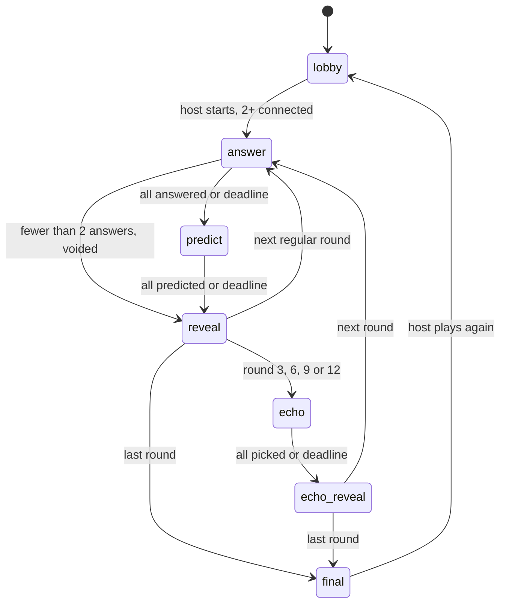

# Read the Room

**A real-time party game for 2–8 phones where the answer key is your friends.**

**Live demo:** https://read-the-room.read-the-room.workers.dev



## Overview

Each round, everyone privately rates a playful question from 1 to 10 ("How dramatic are you when you have a mild cold?"), then predicts the **room's average**. There are no right answers, only how well you read the people you're playing with. Every third round is an **Echo Round**: a question generated from the room's own earlier answers, so the longer a group plays, the more the game is about that group.

Players join from their own devices with a 4-letter room code, QR code or invite link. No accounts, no install. The server is the only authority on state, timing and scoring, and nobody's hidden answer is ever sent to another player.

## Key features

| Area | What's implemented |
|---|---|
| **Multiplayer** | Rooms of 2–8 players plus up to 8 spectators; 4-letter codes (no I, L, O); live lobby with presence; QR / share link; host controls (6, 9 or 12 rounds) |
| **Core game** | Secret 1–10 answers; prediction of the group average (yours included); up to 100 points for closeness, **+50 Bullseye** within 0.3, **+25 Wildcard** for the single most extreme answer |
| **Echo Rounds** (rounds 3, 6, 9, 12) | **Higher or lower** (how many earlier answers beat a threshold), **Room pattern** (which earlier question had the highest/lowest average or biggest spread), **Who said it?** (only for players who opted in) |
| **Consent** | Per-player, off by default, lobby-only switch; others see only a count; the named subject makes a decoy pick so nothing gives them away |
| **Reliability** | Resume tokens restore your seat after refresh or network loss; server-side deadlines with alarms; deadlines enforced on arrival; host hand-over; late joiners spectate; rematch; abandoned rooms deleted after 10 min; client watchdog for dead connections |
| **Results** | Awards (Mind Reader, Bullseye King, Wildcard, Echo Master, Poker Face) and a Room Report (highlights + round-by-round recap) built only from data every player already saw, with copy/share |
| **Experience** | Animated dot-plot reveals, score count-ups, synthesized sound with a mute toggle, reduced-motion support, keyboard-operable radio groups, live-region announcements, layouts tested down to 320 px |
| **Security** | Strict message validation, per-socket and per-IP rate limits, hashed tokens, idle-socket eviction, CSP and related headers |

## Technology

| Layer | Technology (from `package.json`) |
|---|---|
| Client | React 19.3, TypeScript 7.0 (strict), Vite 8.3, `qrcode`, self-hosted Bricolage Grotesque + Inter (`@fontsource-variable`) |
| Server | Cloudflare Workers, one **Durable Object per room** with SQLite-backed storage, hibernatable WebSockets and alarms |
| Tooling | Wrangler 4.155, `@cloudflare/vite-plugin` 1.66 (runs the real `workerd` runtime locally), Vitest 5.0, Playwright 1.64 |

No database, queue or third-party service beyond Cloudflare. No paid APIs.

## Architecture



### Client (`src/`)
A single-page React app with two routes (`/` and `/r/:code`). `src/net/useRoom.ts` owns the WebSocket: it authenticates with a stored resume token (or joins by name), reconnects with jittered exponential backoff, resumes when the tab becomes visible, and runs a **liveness watchdog**: if `hello`/`resume` isn't answered within 6 s, or nothing arrives for 45 s, it drops the socket and reconnects. The client holds no game logic beyond display; it renders whatever personalised snapshot the server sends.

### Front Worker (`worker/index.ts`)
A small router. Static assets are served directly by Workers Static Assets; only `/api/*` runs code:

| Route | Purpose |
|---|---|
| `POST /api/rooms` | Allocate a free code and initialise its Durable Object |
| `GET /api/rooms/:code` | `{ exists, phase, players }` |
| `GET /api/rooms/:code/ws` | WebSocket upgrade, forwarded to that room's Durable Object |

Best-effort per-IP limits: 10 room creations and 120 lookups/upgrades per minute.

### Room Durable Object (`worker/room.ts`)
One instance per room code is the single authority for that room. For every event it: validates the frame (`shared/protocol.ts`), applies it with the pure engine, writes the new state to **synchronous SQLite-backed KV** (`ctx.storage.kv`), re-arms a **single alarm** for the next deadline, and broadcasts a **redacted view** to each socket. All of that happens in one synchronous block, so events can't interleave mid-update, and outgoing messages are held until the write is durable.

- **Identity:** a server-issued UUID plus a 256-bit resume token, sent once to its owner; only its SHA-256 hash is stored.
- **Hibernation:** WebSockets are hibernatable; keep-alive pings are answered by the runtime (`setWebSocketAutoResponse`) without waking the object.
- **Admission:** at most 32 sockets per room; at the cap the oldest never-identified socket is evicted, so idle connections can't lock players out.
- **Migration:** state carries a schema version; rooms saved by the pre-Echo release are upgraded on load.

### Engine and state machine (`shared/`)
`applyAction(state, action, now) → state | error` is pure and deterministic (seeded PRNG, no I/O, no clock), which is what makes the rules unit-testable and replayable.



- A phase ends early once every **connected** participant has submitted (minimum two); disconnected players never block. Deadlines (20 s to answer/predict/pick, 12 s reveals) are enforced on arrival.
- **Scoring** (`shared/scoring.ts`): prediction points = `round(100 × max(0, 1 − |prediction − mean| / 3))`, computed at full precision; Bullseye +50 within 0.3; Wildcard +25 to a unique answer at least 2 from the mean. Echo picks: exact 100, off-by-one 50 (Higher or lower); correct 100 (others); a Who-said-it subject gets +25 per wrong guess, max 100.
- **Echo generation** (`shared/echo.ts`) uses only earlier non-voided rounds, is generated once and stored with the round, so reconnects and restarts can't change a question.
- **Redaction** (`shared/redact.ts`) is the only way state leaves the server: during a phase you see *that* others submitted, never *what*; reveals show anonymous counts.

Full rules: [docs/RULES.md](docs/RULES.md) · Echo design: [docs/ECHO_ROUNDS.md](docs/ECHO_ROUNDS.md) · Wire protocol: [docs/PROTOCOL.md](docs/PROTOCOL.md)

## Repository structure

```
.
├── src/                      React client
│   ├── main.tsx, App.tsx, router.ts, styles.css
│   ├── net/useRoom.ts        WebSocket session: resume, backoff, watchdog
│   ├── screens/              Landing, Lobby, Game (answer/predict/reveal), Echo, Final, RoomScreen
│   ├── components/           ui.tsx (avatars, countdown, slider, dot plot), useRadioKeys.ts
│   └── lib/                  api, storage, hooks, sound, reportText
├── worker/
│   ├── index.ts              HTTP routes, rate limits, upgrade
│   └── room.ts               Room Durable Object
├── shared/                   Pure, shared engine
│   ├── engine.ts  echo.ts  scoring.ts  report.ts  redact.ts
│   └── protocol.ts  rules.ts  prompts.ts  rng.ts
├── tests/
│   ├── unit/                 Vitest (engine, scoring, Echo, timing, alarms, redaction, report, protocol)
│   ├── integration/run.mjs   Multi-client WebSocket games against the local Workers runtime
│   ├── e2e/                  Playwright specs
│   └── upgrade/v1-to-v2.mjs  Real storage-upgrade test across releases
├── docs/                     Rules, protocol, Echo design, readiness review, playtest checklist, showcase kit
├── public/                   favicon.svg, _headers (security headers)
├── showcase/                 Cover image (+ source and render script), screenshots
├── wrangler.jsonc            Worker, Durable Object binding, migration, test-only envs
├── worker-configuration.d.ts Generated runtime/Env types (npm run cf-typegen)
└── vite.config.ts, vitest.config.ts, playwright.config.ts, tsconfig*.json
```

## Getting started

**Prerequisites:** Node.js **22.12 or newer** (developed with Node 24.20 and npm 11.19). A Cloudflare account is only needed to deploy.

```bash
git clone https://github.com/shreyas0917/Read-the-Room.git
cd Read-the-Room
npm ci
npm run dev            # http://localhost:5173: Worker + Durable Objects run locally in workerd
```

Open the URL in a normal and a private window to play with two "devices", or run `npm run dev -- --host` and join from a phone on the same network. No environment variables or secrets are required (so there is no `.env.example`); configuration lives in `wrangler.jsonc`.

## Testing

| Command | Covers |
|---|---|
| `npm run typecheck` | Strict TypeScript across client, Worker and tests (`tsc -b`) |
| `npm test` | **102 unit tests**: scoring and ties, every phase transition, invalid/duplicate/late actions, Echo generation and determinism, consent, redaction (no secret fields in any view), Room Report and awards, alarm scheduling (no re-arm loops), protocol validation, v1→v2 migration |
| `npm run test:integration` | **7 scenarios** over real WebSockets against the local Workers runtime (timers ×0.5): full games with Echo Rounds and independently computed scores, all three Echo modes with consent, reconnects, deadlines with no submissions, rate limits, idle-socket lock-out attempt, and **runtime restarts mid-game and mid-Echo** |
| `npm run test:e2e` | **6 Playwright tests**: a 2-device game + Room Report on the production build, 320 px no-overflow with max-length names, connection recovery, zero CSP violations, and a 4-device Who-said-it game (consent privacy, decoy, keyboard-only, refresh/offline reconnects) |
| `node tests/upgrade/v1-to-v2.mjs <oldCommit> <scratchDir>` | Runs an older commit in a temporary worktree, saves a mid-game room, hands its storage to `HEAD` and plays on |

First run of the browser tests: `npx playwright install chromium`. Don't run `npm run dev` while the e2e suite runs: local runtimes share `.wrangler/state`.

Test-only Wrangler environments: `test` (integration, timers ×0.5) and `e2e` (seedable rooms) set `ALLOW_TEST_SEED`, which lets a test fix a room's PRNG seed. Production never defines it.

## Deployment

```bash
npx wrangler login              # once
npx wrangler deploy --dry-run   # inspect: only TIMER_SCALE="1", the ROOMS binding, migration v1
npm run deploy                  # tsc + vite build + wrangler deploy
```

Cloudflare configuration (all in `wrangler.jsonc`): a Worker named `read-the-room`, Workers Static Assets with SPA fallback and `/api/*` routed to the Worker, a Durable Object binding `ROOMS → Room` with a `new_sqlite_classes` migration (works on the free plan), and `TIMER_SCALE = "1"`. Rollback: `npx wrangler deployments list`, then `npx wrangler rollback <version-id> --name read-the-room`.

To check a deployment, point the suites at it (local-only scenarios skip themselves):

```bash
BASE_URL=https://read-the-room.read-the-room.workers.dev node tests/integration/run.mjs
BASE_URL=https://read-the-room.read-the-room.workers.dev npx playwright test
```

## Security and privacy

- **Server-authoritative:** clients send intents; every action is validated for type, fields, range, phase, role and duplicates. Scores are computed only on the server.
- **No answer leaks:** redaction is the single exit path for state; integration and e2e tests scan every message for hidden fields. During development the privacy and consent rules were deliberately broken one at a time to confirm those tests fail (manual mutation checks; not an automated suite).
- **Names on answers** appear only for the Wildcard (stated in the rules) and an opted-in Who-said-it subject. Aggregates are *not* a privacy guarantee: with two players, the average and your own answer reveal the other answer. This is documented.
- **Tokens:** random 256-bit, hashed at rest, never sent to other players, kept in the owner's `localStorage`. There are no cookies, so cross-site WebSocket use can't act as a player.
- **Abuse controls:** 1 KB message cap; 40 messages / 10 s per socket (80 closes it); per-IP creation and lookup limits; idle-socket eviction at the socket cap.
- **Headers:** CSP (`default-src 'self'`, `frame-ancestors 'none'`, `object-src 'none'`), `nosniff`, `X-Frame-Options: DENY`, referrer and permissions policies.
- **Room Report** sharing is plain text built from public data, only when a player presses Copy or Share.

Review with severities and evidence: [docs/READINESS_REVIEW.md](docs/READINESS_REVIEW.md).

## Known limitations and status

- **Production incident (2026-10-29).** A scheduling bug made rooms whose players had all left re-arm their alarm every 50 ms until deletion, which exhausted the Durable Objects free plan's 100,000 rows-written/day quota. Room creation failed with `Exceeded allowed rows written` from then until the daily reset (00:00 UTC). The fix plus a regression suite (`tests/unit/alarms.test.ts`) is deployed as version `b2ad83bf`. **Live re-verification after the reset is still pending** at the time of writing.
- **Playtest status:** automated tests run in Chromium (desktop, 390 px and 320 px phone viewports). Real phones, Safari/iOS, Firefox, screen readers, real audio and real groups of players **have not been tested yet**. The plan is in [docs/PLAYTEST_CHECKLIST.md](docs/PLAYTEST_CHECKLIST.md).
- No host kick or room lock: anyone with a code can join a lobby (spectators see only public data).
- Per-IP limits are best-effort (per isolate); a distributed client could still burn the free plan's daily quota.
- Capacity on the free plan is an estimate (a few hundred full games per day), not a measurement; no load testing has been done.

## Roadmap

- Fix whatever real-device playtests turn up (Safari, slow networks, screen readers).
- Host controls: kick and lock room.
- Custom and themed question packs.
- Usage visibility (rows written / requests per game) from Cloudflare analytics.

## Author

**Shreyas Wani**, design, development and deployment.
